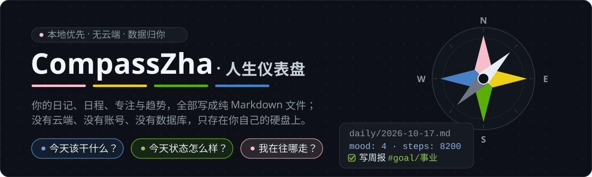

# CompassZha · 人生仪表盘

[](./LICENSE)
[](#系统要求)
[](https://tauri.app)
[](https://svelte.dev)
[](https://www.typescriptlang.org)
[](https://github.com/zhadao/CompassZha/releases/latest)
[](https://github.com/zhadao/CompassZha/releases)

<p align="center">
  
</p>

一个运行在 Windows 本地的**个人「人生仪表盘」**桌面应用。数据全部以 Markdown 文件保存在你自己
的硬盘上，没有云端、没有账号、没有数据库。

它只回答三个问题：

| 问题 | 对应模块 |
| --- | --- |
| **今天该干什么？** | 今日清单、日历日程、番茄钟 |
| **今天状态怎么样？** | 量化指标录入、仪表盘八项指标卡与趋势曲线 |
| **我这个人在往哪走？** | 人生板块、板块投入热力图、长期趋势 |

> English readers: see [English](#english) at the bottom.

---

## 目录

- [核心特点](#核心特点)
- [功能一览](#功能一览)
- [界面分区](#界面分区)
- [系统要求](#系统要求)
- [快速开始](#快速开始)
- [数据存放与格式](#数据存放与格式)
- [项目结构](#项目结构)
- [技术选型](#技术选型)
- [路线图](#路线图)
- [参与贡献](#参与贡献)
- [许可证](#许可证)

---

## 核心特点

- **AI Native 数据格式**：日记、任务、日程、专注记录、板块笔记全部是纯 Markdown 文件。
  没有专有格式、没有加密数据库，可直接丢给任意 AI 或脚本分析，几十年后依然可读。
- **章节级「手术式」写回**：应用只替换被你修改的那个章节，文件里其余内容**字节级原样保留**，
  你手动编辑过的文件永远不会被程序重排或规范化。
- **本地 git 时间机器**：每次保存自动 commit 到本地数据仓库（纯本地、不联网、默认不推送），
  随时可以回看或恢复任意历史版本。
- **轻录入、重回看**：录入动作尽量少点击（表单一次填完九项指标），价值集中在仪表盘、日历与
  长期趋势这些「回看」场景。
- **不造轮子**：编辑器、日历、图表、解析器一律使用成熟的开源组件，项目本身只写业务胶水层。
- **数据完全属于你**：无遥测、无账号体系、无服务器。日记与量化数据永远只在本地读写；
  只有当你主动使用「语料对话」或「AI 数据分析」时，才会把**你选择发送的内容**经你自己填写的
  AI API 发出（API Key 只存系统凭据管理器，软件不内置任何密钥，也绝不把你的数据发给第三方）。

## 功能一览

### 每日日记

- 自动按 `daily/yyyy/yyyy-mm-dd.md` 创建当天文件，已存在则**永不覆盖**。
- YAML frontmatter 承载九项量化指标：睡眠时长、睡眠质量、入睡时间、起床时间、体重、
  当日支出、心情、专注时长、运动步数。
- 正文固定五个章节：`## 日程`、`## 今日清单`、`## 临时记录`、`## 专注记录`、`## 今日收尾`。
- **日记日历（迷你月历）**：点击某一天即查看或创建那天的日记并跳转编辑；
  有日记的日期显示圆点，今天描边高亮。
- **右键日期菜单**：打开 / 收藏切换 / 删除（删除需二次确认）。
  收藏会把文件原子改名为 `star-yyyy-mm-dd.md`，并在月历上以星标高亮——收藏状态由文件名派生，
  重启不丢，不依赖任何额外配置。
- **双模式编辑器**：表单模式（填指标、勾任务）与所见即所得 Markdown 编辑器模式，
  两种模式共享同一份数据，随时切换。

### 今日清单

- 当日文件内的 `- [ ]` 列表，勾选状态实时写回磁盘。
- 未完成项可一键顺延到次日。

### 日历

- 基于 FullCalendar，提供日 / 周 / 月 / 清单四种视图，带当前时间指示线与「更多」展开。
- 点击空白格新建事件，拖拽调整时间，点击事件编辑或删除。
- 事件写入当日 `## 日程` 章节，格式为定时 `- HH:mm-HH:mm 标题`、全天 `- 全天 · 标题`，
  按时间排序——**单个文件就是一天的全貌**，可直接喂给 AI。
- 所有改动经 500ms 防抖批量落盘，附带本地 git 提交。

### 番茄钟

- **倒计时模式**：预设 10 / 25 / 40 分钟，支持自定义时长与任务标题，到点自动记录。
- **正计时模式**：不知道会专注多久时使用，停表那一刻即结束并记录。
- 计时在全局运行，切换到其他分区也继续走；每条记录追加到当日 `## 专注记录`
  （格式 `- HH:mm · 标题 · N 分钟 · 模式`），并累加 frontmatter 的 `focus_minutes`。

### 仪表盘

- **当日八项指标卡**：睡眠时长、入睡时间、起床时间、体重、当日支出、心情、专注时长、运动步数。
- **趋势七折线**：近 7 / 30 / 90 天可切换，统一采用折线形式（平滑曲线），覆盖
  ①睡眠时长 ②入睡 / 起床时间双折线 ③体重 ④当日支出 ⑤心情 ⑥专注时长 ⑦运动步数。
- **板块投入热力图**：GitHub contribution 风格的日历热力图（正方形格子 + 圆角 + 5 档绿色梯度，
  统计近一年，悬停显示当日详情）。你在人生板块每新建一个板块，仪表盘就多一张对应的热力图；
  颜色深浅取决于当日清单里带 `#goal/<板块名>` 标签的任务**提及次数**（与任务是否勾选无关），
  用来可视化「我今天有没有在推进它」。

### 人生板块

- 每个板块 = `life/` 下的一个**子文件夹**（Obsidian 式）。板块由你自己建，初始为空。
- 点卡片进入「板块文件夹视图」：左侧该板块的 Markdown 文件列表，右侧编辑器实时落盘。
- 板块内可**新建 / 重命名 / 删除**多个 Markdown 文件，分别梳理同一板块的不同思路。

### 语料对话（AI）

- 把任意 Markdown 语料直接丢进数据目录的 `corpus\`——**不需要分类建文件夹**，交叉主题也只放一份，
  主题筛选交给 AI 在检索时完成。
- 在「语料对话」分区提问：AI 先在**你本地**检索语料，再以检索结果为据作答，并列出引用出处
  （引用到具体文件）。
- 检索走轻量 RAG：AI 扩词选卡 → 本地关键词打分检索 → 生成回答；语料不足时明确提示
  「未得到语料库的充分支撑」后由 AI 直接作答，不会硬凑。
- **索引卡**：8 张主题卡是 AI 的**检索筛选器**（不是文件夹），可在界面内编辑其关键词以调整检索路由。
- 提供「资源跳转」（直接打开语料文件夹）与「说明」（API 使用 / 语料存放 / 隐私说明）。

### 仪表盘 AI 数据分析（AI）

- 仪表盘**顶端**的「📊 AI 数据分析」按钮，点击弹出独立对话窗（不占用新的左侧分区）。
- AI 基于你已录入的量化指标（睡眠时长、睡眠质量、入睡 / 起床时间、体重、当日支出、心情、
  专注时长、运动步数）做统计、趋势分析与建议——例如「哪几天睡得比较晚」「这个月支出怎么样」。
- 该工作区**只回答数据相关问题**，其余提问统一回复「该工作区只能回答数据相关的问题。」，
  不会变成漫无边际的聊天机器人。
- 每次提问只发一次 AI 调用，且只上传这九项数字（**不传日记正文**）。

### 数据同步（GitHub / Gitee 私密仓库）

- 把整个 `data\` 目录同步到**你自己**在 GitHub 或 Gitee 上的**私密**仓库；程序不内置任何账号、
  密钥或仓库地址，一切由你在设置页填写（国内网络建议选 Gitee）。
- **认证方式二选一**：
  - **自动（默认）**——认证完全交给本机 git：`https://` 地址走**系统凭据管理器**（首次登录一次，
    之后长期免输入），`git@…` 地址走 **`~/.ssh` 密钥**。软件不读取、不保存、不转发你的账号密码或令牌，
    也不需要你在软件里输任何凭据。
  - **私人令牌**——机器上没有可用凭据时使用；令牌只存 Windows 系统凭据管理器，
    推送时一次性注入请求头，**不落盘、不进 `.git/config`**。
- 同步时机可选「打开软件时 / 每次保存后 / 定时」，也可随时手动「立即同步」；
  首次同步若远端已有内容，会自动接续远端历史后重试，不会删除你的任何数据。

### 官方说明书（内置）

- 设置页右上角**「详细说明」按钮**打开内置说明书，共 16 章覆盖全部功能：起步、**数据同步**
  （建私密仓 / 两种认证 / **SSH 公钥分步教程** / **私人令牌分步教程** / 字段对照 / 排错）、
  AI 配置、今日与日记、日历、仪表盘、人生板块、番茄钟、隆中对、数据目录与隐私、FAQ。
- 左侧目录可点击跳转；正文里的**高亮关键词**点一下即跳到对应章节；外部链接（GitHub / Gitee 建仓页、
  令牌生成页、DeepSeek 开放平台等）**直接用系统浏览器打开**，跟着走一遍就能把设置配完。

### 单实例运行

- 同一时刻只允许**一个**运行实例：重复双击 exe 不会冒出一堆窗口与托盘图标，而是唤回并聚焦
  已经打开的那个窗口（最小化到托盘时也会重新显示）。

## 界面分区

左侧竖导航固定七个分区，三栏布局（导航 / 主区 / 右栏详情）：

| 分区 | 内容 |
| --- | --- |
| 每日 | 当天日记正文、清单、指标表单、迷你日记月历 |
| 日历 | FullCalendar 四视图、事件编辑器、当日 Markdown 预览 |
| 仪表盘 | 八项指标卡、趋势七折线、板块投入热力图、AI 数据分析入口 |
| 人生板块 | 板块卡片网格 / 板块文件夹视图 |
| 番茄钟 | 双模式计时器与历史专注记录 |
| 语料对话 | 语料问答（带出处引用）、索引卡编辑、说明 |
| 设置 | 数据目录、git 同步（认证方式：自动 / 私人令牌）、AI 配置（主 API + 可选的数据分析专用 API）、右上角「详细说明」说明书入口 |

窗口宽度分三档响应式（≥1280 / 800–1280 / <800），右栏可手动收起。

## 系统要求

| 项 | 要求 |
| --- | --- |
| 操作系统 | Windows 10 / 11 64 位 |
| WebView2 | 系统自带（如缺失，安装 [Evergreen Runtime](https://developer.microsoft.com/microsoft-edge/webview2/)） |
| 运行安装版 / 便携版 | 无需其他依赖 |
| 从源码构建 | Node.js ≥ 18、Rust ≥ 1.77（stable-msvc）、Visual Studio Build Tools |

## 快速开始

### 方式一：直接安装（推荐普通用户）

当前最新版本 **v0.2.8**（变更明细见 [CHANGELOG.md](CHANGELOG.md)）。
前往 [**Releases**](https://github.com/zhadao/CompassZha/releases/latest) 下载，两种形态任选：

| 下载文件 | 形态 | 说明 |
| --- | --- | --- |
| `CompassZha_*_x64-setup.exe` | **安装版** | 标准 Windows 安装向导（含 MIT 协议页），可自选安装位置，默认装到 `D:\CompassZha`；卸载走系统「应用和功能」 |
| `CompassZha_v*_portable_win64.zip` | **便携版** | 解压到任意目录，双击 `CompassZha.exe` 即用，无需安装 |

两种形态的数据都自动存放在**程序目录下的 `data\` 文件夹**（与 exe 同级）；首次启动会自动生成全部目录与当天的 Markdown 文件。

### 方式二：从源码构建

```bash
git clone https://github.com/zhadao/CompassZha.git
cd CompassZha

npm install                       # 安装前端依赖
npm run tauri dev                 # 开发模式（带热更新）

npm run check                     # 类型检查（提交前必过）
npm run tauri build -- --no-bundle  # 生成免安装可执行文件
```

产物位置：`src-tauri/target/release/compass.exe`。

## 数据存放与格式

数据全部写在**程序目录下的 `data\` 文件夹**（安装版与便携版一致，数据永远跟着程序走）；若从源码以开发模式运行，则写在 **`%APPDATA%\CompassZha`**。目录结构如下：

```
{数据根}\                          # 安装/便携版 = 程序目录\data\；开发模式 = %APPDATA%\CompassZha
├─ config.json                     # 应用配置（外观 / AI / Git / 关闭行为等）
├─ README.md                       # 数据目录说明（首次启动自动生成）
├─ daily\
│  └─ 2026\
│     ├─ 2026-10-16.md             # 一天的完整记录（日记 + 日程 + 清单 + 指标）
│     └─ star-2026-10-15.md        # 收藏过的日记
├─ life\
│  ├─ 健康\                         # 一个板块 = 一个文件夹
│  │  ├─ 健康.md                    # 默认文件（frontmatter 的 icon 决定卡片图标）
│  │  └─ 睡眠实验.md
│  └─ 事业\
│     └─ 事业.md
├─ events\                         # 循环事件规则库（循环日程只记规则，不预生成远期事件）
├─ corpus\                         # 语料库（AI 语料对话检索；直接丢 .md 进来即可，无需分类）
├─ conversations\                  # AI 对话归档（应用内「保存本轮对话」写入）
└─ .backup\                        # 本地快照（自动维护，不进 Git）
```

> **换数据目录**：首次启动后编辑数据目录里的 `config.json`，把 `data_root` 指向你想要的路径即可。
> `config.json` 自身从默认根目录读取，因此第一步必须先让应用在默认目录完成首次初始化。

单日文件长这样（完整字段说明见 [docs/DATA-FORMAT.md](docs/DATA-FORMAT.md)）：

```markdown
---
date: 2026-10-16
sleep_hours: 7.5
sleep_bedtime: "23:30"
sleep_wake: "07:00"
weight_kg: 68.2
spend_total: 45.5
mood: 4
focus_minutes: 50
steps: 8200
---

## 日程
- 09:00-10:00 深度工作
- 全天 · 散步

## 今日清单
- [x] 写周报 #goal/事业
- [ ] 整理房间

## 临时记录
随手写下的东西。

## 专注记录
- 09:05 · 写周报 · 25 分钟 · 倒计时
- 14:20 · 读书 · 25 分钟 · 正计时

## 今日收尾
今天还不错。
```

## 项目结构

```
CompassZha/
├─ src/                            # 前端（Svelte 5 runes + TypeScript 严格模式）
│  ├─ App.svelte                   # 三栏布局与分区路由
│  ├─ components/
│  │  ├─ layout/                   # Sidebar / DetailPanel / 文件树
│  │  ├─ today/                    # 每日分区：日记、清单、指标表单、迷你月历
│  │  ├─ calendar/                 # 日历分区：FullCalendar 封装、事件编辑器
│  │  ├─ dashboard/                # 仪表盘：指标卡、趋势图、热力图、AI 数据分析弹层
│  │  ├─ pomodoro/                 # 番茄钟：双模式计时器、专注记录列表
│  │  ├─ life/                     # 人生板块：卡片网格、板块文件夹视图
│  │  ├─ chat/                     # 语料对话：对话线程、索引卡编辑、语料转化、说明
│  │  ├─ common/                   # 通用组件（Crepe 编辑器封装等）
│  │  ├─ manual/                   # 内置说明书（外壳 + 章节内容 + 设置页入口按钮）
│  │  └─ settings/                 # 设置分区（数据目录 / git 同步 / AI 配置）
│  ├─ stores/app.svelte.ts         # 全局状态单例，组件与数据源之间的唯一接缝
│  ├─ lib/
│  │  ├─ markdown.ts               # Markdown 解析与「章节级写回」
│  │  ├─ tauri-fs.ts               # 数据层 invoke 包装（路径安全层）
│  │  ├─ ai.ts                     # AI 对话 / 数据分析 invoke 包装
│  │  └─ date.ts                   # 日期工具
│  ├─ mock/preview.ts              # 浏览器预览兜底数据 + id 生成器
│  ├─ types/schema.ts              # 领域模型类型定义
│  └─ tokens.css                   # 全部设计变量集中于此
├─ src-tauri/                      # 后端（Rust）
│  ├─ src/
│  │  ├─ main.rs                   # 进程入口
│  │  ├─ lib.rs                    # 应用装配与命令注册
│  │  ├─ fs_cmds.rs                # 文件系统命令（异步 + 路径校验 + 无黑窗 git 子进程）
│  │  ├─ git_sync.rs               # GitHub / Gitee 私密仓库同步（默认交还本机 git 凭据；令牌模式只进系统凭据管理器）
│  │  ├─ ai_chat.rs                # AI 对话与数据分析（DeepSeek 直连，Key 只进凭据管理器）
│  │  ├─ corpus_search.rs          # 本地轻量语料检索（关键词打分）
│  │  ├─ corpus_import.rs          # 语料转化（epub / pdf → Markdown，纯 Rust 本地转换）
│  │  └─ config_topics.rs          # 索引卡读写
│  ├─ icons/                       # 应用图标
│  └─ tauri.conf.json
├─ docs/                           # 架构、数据格式、路线图
├─ .github/                        # Issue / PR 模板与 CI
├─ CONTRIBUTING.md
├─ CHANGELOG.md
└─ LICENSE
```

## 技术选型

| 层 | 选型 | 说明 |
| --- | --- | --- |
| 桌面壳 | [Tauri 2](https://tauri.app) | 体积小、内存占用低，复用系统 WebView2 |
| 后端 | Rust 2021 | 文件系统命令、路径安全校验、后台 git 子进程 |
| 前端 | [Svelte 5](https://svelte.dev)（runes）+ Vite 6 + TypeScript 严格模式 | 无虚拟 DOM，状态即数据 |
| 编辑器 | [Milkdown Crepe](https://milkdown.dev)（MIT） | 所见即所得 Markdown，仅保留静默写作功能 |
| 日历 | [FullCalendar 6](https://fullcalendar.io)（MIT） | 日 / 周 / 月 / 清单视图与拖拽交互 |
| 图表 | [Apache ECharts 6](https://echarts.apache.org) | 趋势七折线；板块投入热力图为自绘 GitHub contribution 风格（非 ECharts） |
| AI | [DeepSeek](https://platform.deepseek.com)（用户自携 API Key） | 语料对话与数据分析；Key 只进系统凭据管理器 |
| 存储 | 纯 Markdown 文件 + 本地 git | 无数据库；语料检索为本地关键词打分，索引可整库重建 |
| 数据同步 | 本机 git（系统凭据管理器 / SSH 密钥） | 同步到**你自己**在 GitHub / Gitee 的私密仓库；默认模式下软件不读取也不保存任何凭据 |

## 路线图

| 阶段 | 内容 | 状态 |
| --- | --- | --- |
| 0 | 交互原型（内存态） | 已完成 |
| 1 | 数据层：Markdown 读写、模板、本地 git 自动提交 | 已完成 |
| 2 | 编辑器升级（CodeMirror 6 → Milkdown Crepe）、日记日历 | 已完成 |
| 3 | 番茄钟双模式、日历接真、仪表盘（指标卡 / 七折线 / 热力图） | 已完成 |
| 4 | 语料库与 AI 对话（本地检索 + 回答带出处）、仪表盘 AI 数据分析 | 已完成 |
| 5 | GitHub / Gitee 私密仓库同步、Windows 安装包 | 主体完成（v0.2.6 起默认「自动」认证：免令牌、走本机凭据管理器与 SSH 密钥；v0.2.2 起提供安装包与便携包） |

详细说明见 [docs/ROADMAP.md](docs/ROADMAP.md)。

## 参与贡献

欢迎提 Issue 与 PR，请先阅读 [CONTRIBUTING.md](CONTRIBUTING.md) 与
[CODE_OF_CONDUCT.md](CODE_OF_CONDUCT.md)。

特别提醒：**请勿在 Issue 或 PR 中粘贴你的真实日记内容**，如需举例请自行脱敏。

## 许可证

本项目基于 [MIT 许可证](./LICENSE) 开源。

---

## English

**CompassZha** is a local-first personal dashboard for Windows, built with Tauri 2 + Svelte 5 +
TypeScript. All your data lives in plain Markdown files on your own disk — no cloud, no account,
no database.

It answers three questions: *What should I do today? How am I doing today? Where am I heading?*

Highlights:

- Plain-Markdown, AI-native data format — readable by any AI or script, forever.
- Surgical section-level writes: only the modified section is replaced; everything else in the file
  is preserved byte-for-byte, so hand-edited files are never reformatted.
- Local git auto-commit after every save (local only, never pushed by default).
- Daily notes with a mini calendar, right-click menu (open / star / delete), and starred-file
  renaming (`star-yyyy-mm-dd.md`).
- Tasks, a FullCalendar-based schedule whose events are written back into the day's Markdown file,
  and a dual-mode Pomodoro timer (countdown + stopwatch) that logs to `## 专注记录`.
- A dashboard with eight metric cards, seven switchable (7 / 30 / 90-day) trend lines, and
  GitHub-contribution-style heatmaps per life area based on `#goal/<area>` tag mentions.
- **Corpus chat**: drop any Markdown into `corpus\` (no folders needed) and ask questions — the AI
  retrieves from your local corpus first, answers with citations, and says so plainly when the corpus
  has nothing to support an answer.
- **Dashboard AI analysis**: ask about your own tracked metrics (sleep, weight, spending, mood,
  focus, steps). This workspace answers data questions only.
- Your own AI API key (DeepSeek) lives in the Windows Credential Manager — never in a file.
  Nothing leaves your machine unless you explicitly use one of the two AI workspaces.

Download the Windows installer (setup wizard, defaults to `D:\CompassZha`) or the portable build
from the [Releases](https://github.com/zhadao/CompassZha/releases/latest) page. Build from source
with `npm install` then `npm run tauri dev`; produce a standalone executable with
`npm run tauri build -- --no-bundle`. Licensed under MIT.

## 致谢 / Acknowledgements

CompassZha 站在以下开源项目的肩膀上（设置页底部「软件作者」弹窗内可一键访问）：

- [Tauri](https://github.com/tauri-apps/tauri) — 桌面应用框架
- [Svelte](https://github.com/sveltejs/svelte) — 前端框架
- [FullCalendar](https://github.com/fullcalendar/fullcalendar) — 日历视图
- [Milkdown](https://github.com/Milkdown/milkdown) — 所见即所得编辑器
- [ECharts](https://github.com/apache/echarts) — 趋势图表
- [usememos/memos](https://github.com/usememos/memos) — 界面风格参考（仅视觉借鉴，未使用其代码）

。
